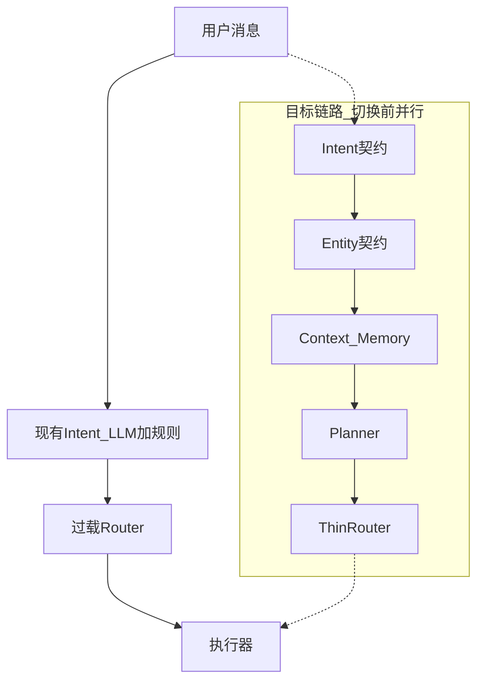

# Agent 决策架构重构计划（中文确认版）

> 本文档对应 Cursor Plan：`decision_architecture_refactor`。  
> **用途：** 供你确认范围、验收标准与执行环境后再决定是否开工。  
> **当前状态：** Phase 0–7 已完成（基线 → 契约 → Intent/Entity/Planner/Thin/Multi-step → E2E Eval）。  
> **生产默认：** 仍为 Legacy Router；`DECISION_PLANNER_ROUTING=off`（可 shadow/on）。  
> 本文档原为开工确认版；执行细节以各 `PHASE*_COMPLETION.md` 为准。

---

## 1. 一句话目标

不要继续把 Router 做得「更聪明」（堆正则），而是：

> **让每个决策由正确的组件负责，并用 Eval 锁住边界与整体可靠性。**

目标链路：

```text
User
→ Intent Understanding
→ Entity Extraction
→ Context / Memory
→ Planner
→ Thin Router
→ Executor
```

---

## 2. 为什么要做

当前自然语言入口已支持多任务族（竞品分析 / 收集 / 轻问 / 简单问答 / 追问 / 域外），但 **Router 职责过载**，同时做了：

- 域外过滤
- 话语关系（是否指向上轮）
- 意图推断
- 工作流选择
- prior / Memory 门控
- 与澄清相关的旁路
- 大量 special-case 正则

典型回归：

> 修一个 follow-up case → 可能误伤 Deep Analysis；加一条语义规则 → 又改变其他任务路由。

因此本次是 **职责解耦**，不是继续加 Router 规则。

---

## 3. 本轮已锁定的决策

| 项 | 决定 |
|----|------|
| **本轮落地范围** | 仅 **Phase 0 + Phase 1** |
| **生产路径** | 仍为 `IntentUnderstandingService → RouterService → ConversationService`，**不切换** |
| **兼容策略** | 保留现有 `IntentUnderstandingResult` / `RoutingDecision` 为 **legacy**；新契约并行 + **adapters**；禁止大爆炸切换 |
| **禁止改动** | Deep / Research / Memory / UI / DB / MCP 等无关重构（记入 Follow-up） |
| **禁止手段** | 用新的全局语义 regex「修架构问题」 |
| **Phase 0–1 允许** | 仅：评测 fixture、文档、DTO 契约、适配器、单测 |
| **Shadow Mode** | 从 **Phase 4/5**（有 Planner）开始，不在 Phase 0 |
| **默认 Deep** | 目标 Planner **禁止隐式默认 Deep**；Phase 0 仍冻结「今天实际行为」以便可测 |



---

## 4. 迁移原则（全程遵守）

1. **不要一次性重构整个 Agent** — 增量迁移  
2. **先 Contract，再改实现**  
3. **先 Eval Baseline，再替换旧逻辑**  
4. **每个 Phase 可独立测试**  
5. **每条新规则必须带正例 + 反例金标**  
6. **禁止用堆 regex 解决架构职责问题**  
7. **禁止隐式默认 Deep**（目标态）  
8. **任务组合用 Plan Steps，不用 Router 优先级互斥**

---

## 5. Phase 0 — Baseline 冻结（不改正式执行逻辑）

### 目标

冻结「系统今天实际怎么判」，避免后续 Phase 静默改行为。

### 做什么

1. 固化现有 Router 金标：
   - `backend/tests/unit/test_router_goldens_pr_v26.py`
   - `backend/tests/fixtures/router_goldens.json`（约 34 条；critical 100%；overall ≥ 95%）
2. **仅增量扩展**金标字段：
   - `tags[]`（如 `ca_launch` / `research` / `follow_up_advice` / `listing` / `oos` / `confusable`）
   - `slice`（固定切片 ID）
   - **原则上不改** `expect_workflow_type`；若必须改标，标注 `baseline_exception` 并写理由
3. 金标 meta 测试增加「切片非空 / 最低覆盖」检查（可先偏软）
4. 写入基线文档：
   - `docs/decision-architecture/PHASE0_BASELINE.md`
   - 可选：`backend/tests/fixtures/router_baseline_snapshot.json`
5. **失败分类（Failure Taxonomy）** 至少覆盖：
   - 话语关系漏检（无「基于刚才」的运营建议）→ 默认 Deep
   - 无效实体（如「它都」）经 Memory 继承
   - listing 与竞品分析双意图
   - 收集嵌套「报告」
   - 澄清挡住轻量路径
   - Router 优先级冲突

### 明确不做

- 不改 `router_service.py` 行为  
- 不改 `conversation_service.py` 路由  
- 不改 Intent Prompt  

### 验收

- 现有 Router 单测 + 金标仍通过当前阈值  
- 基线文档含：critical 列表、切片图、失败分类、「无正反例不得改规则」  
- 填写 Phase 完成清单（见第 9 节）

---

## 6. Phase 1 — Contract 设计（契约 + 适配器，仍不切生产）

### 目标

冻结目标决策契约，让 Phase 2+ 对着类型实现，而不是对着 Router 正则实现。

### 新增模块（建议路径）

`backend/app/application/dto/decision/`

| 文件 | 职责 |
|------|------|
| `intent_contract.py` | `TaskFamily` / `Discourse` / `AskSubtype` / `DecisionIntent` |
| `entity_contract.py` | `EntitySlot` / `DecisionEntities` / source / missing_slots |
| `context_contract.py` | `DecisionContext`（prior、report/task、memory 快照） |
| `plan_contract.py` | `ExecutionMode` / `PlanStep` / `ExecutionPlan` / 澄清字段 |
| `adapters.py` | Legacy ↔ 新契约映射（允许有损，但必须显式） |
| `__init__.py` | 对外导出 |

### 契约字段（v1 锁定）

**DecisionIntent（意图）**

- `task_family`：`analyze | collect | ask | advise_prior | oos`
- `ask_subtype`：`listing | definition | dynamics | advice | other | null`
- `discourse`：`new | continue_prior | upgrade_prior`
- `objective` / `focus`：可选
- `confidence`：float
- `raw_message`：str
- `signals`：可选调试列表（Phase 1 不用于生产分支）

**DecisionEntities（实体）**

- `company` / `product` / `competitors` / `time_range`（可选）
- 每槽 `source`：`message | prior | memory | curated | inferred | unknown`
- 每槽 `confidence`
- `missing_slots`
- **原则：槽位填满 ≠ 必须启动 Deep**

**DecisionContext（上下文）**

- `has_prior_artifact` / `prior_workflow_type` / `prior_task_id` / `prior_report_id`
- `memory_company` / `memory_competitors` / `memory_product`（扁平快照，不改 Memory 存储）
- `conversation_id` / `project_id`

**ExecutionPlan（计划）**

- `clarification_required` + `clarification_question`
- `execution_mode`：`clarify | short_answer | research | deep_fast | deep_full | follow_up | multi_step | oos`
- `workflow_type`：与现网兼容，供日后 Thin Router 使用
- `steps`：`PlanStep[]`
- `planner_confidence` / `reason`
- **无 analyze / upgrade 信号时，不得隐式 `deep_*`**（Phase 4 Planner 强制；Phase 1 写入契约说明）

### 适配器（Phase 1）

- `legacy_intent_to_decision_entities(...)`
- `routing_context_to_decision_context(...)`
- `execution_plan_to_routing_decision(...)`（映射表 stub；**Phase 5 前不进生产**）
- **不接入** `ConversationService`

### 测试与文档

- 契约构造 / 校验单测  
- 适配器冒烟（含 `follow_up` plan → `RoutingDecision.workflow_type == follow_up`）  
- `docs/decision-architecture/PHASE1_CONTRACTS.md` 写清映射表  

### 验收

- 新 DTO 可 import；测试全绿  
- **生产调用点零改动**  
- 与 Phase 0 各切片能映射到目标 `task_family` + `execution_mode`

---

## 7. Phase 2–7 路线图（本轮不编码，仅确认方向）

每一 Phase 必须满足上一 Phase 验收 + 金标门禁后才可开始。

| Phase | 交付 | 是否切生产 |
|-------|------|------------|
| **2 Intent Extraction** | 独立 `DecisionIntentExtractor`（规则优先，从现有 signal 迁出 Router；LLM 可后置）；`task_family`/`discourse` 独立金标 | 否（可 shadow 对比） |
| **3 Entity Extraction** | 封装现有 `intent_entities` + Memory 回填；输出带 source 的 Entities；**绝不直接触发 Workflow** | 否 |
| **4 Planner** | `plan(intent, entities, context) → ExecutionPlan`；澄清 vs 执行；**禁止默认 Deep**；规则正反例成对 | 仅 Shadow |
| **5 Thin Router** | `Plan → Capability`；ConversationService 特性开关切换；冻结旧 Router 语义正则 | 特性开关切换 |
| **6 Multi-step** | listing→deep、collect→advice 等 PlanStep 组合 | 开关开启后可用 |
| **7 E2E Eval** | 全链路评测（新开分析 / 收集 / listing / QA / 追问短答 / 追问升级 / 歧义 / 无效指代 / Memory 补全 / 组合 / OOS） | 默认开启前必过 |

### Shadow Mode（Phase 4+）

记录结构示例：

```text
message / old_workflow / new_execution_mode / expected?
intent / plan_reason / confidences
```

离线对比；未达门禁前对用户无感。

---

## 8. 回归门禁（每一 Phase）

至少运行：

```bash
cd backend && PYTHONPATH=. pytest \
  tests/unit/test_router_goldens_pr_v26.py \
  tests/unit/test_router_service_pr_v21.py \
  tests/unit/test_intent_mapper_routing.py \
  tests/unit/test_follow_up_service.py \
  tests/unit/test_decision_* \
  -q
```

要求：

- **critical = 100%**
- **overall ≥ Phase 0 baseline**
- 任一失败必须定位根因并写入完成清单，才能进下一 Phase

防回归铁律：Phase 2 之后每条规则必须带 **正例 + 反例** 金标（例如：运营建议追问 → follow_up；**同时** 有 prior 但显式「竞品分析报告」→ 仍 Deep）。

---

## 9. 每个 Phase 完成时必须输出

1. 修改了什么  
2. 没有修改什么  
3. 新增了什么 Contract  
4. 修改了哪些模块  
5. 测试结果  
6. Regression 结果  
7. 新发现的问题 / Follow-up Task  
8. 下一 Phase 建议  

---

## 10. 严格范围控制（禁止清单）

本计划禁止顺手做：

- 无关 UI 重构  
- 无关 Deep Workflow 重构  
- 无关 Research 重构  
- 无关 Memory 重构  
- 无关 MCP 重构  
- 无关数据库迁移  
- 为单一 case 加全局语义 regex  

其他问题一律记 **Follow-up Task**，不在当前 Phase 处理。

---

## 11. 建议执行顺序（你确认后）

1. **Phase 0**：基线文档 + 金标 tags/slices + 失败分类（**零运行时行为变更**）  
2. **Phase 1**：`dto/decision/*` 契约 + adapters + 单测 + 契约文档（**不接入会话主路径**）  
3. **停止**，提交 Phase 0/1 完成清单，等待你决定是否进入 Phase 2  

---

## 12. 执行环境确认清单（请你勾选后回复）

请确认下列事项后再让我执行：

### A. 是否执行

- [ ] **同意执行 Phase 0 + Phase 1**  
- [ ] 暂不执行，仅保留本文档  
- [ ] 缩小范围：只做 Phase 0  
- [ ] 扩大范围：本轮做到 Phase 2（Intent 抽取，仍不切生产）

### B. 在什么环境执行

- [ ] **仅本地仓库**（当前 `product-tools` 工作区）：改代码 + 跑单测，不部署  
- [ ] 本地 + 启动/使用现有 backend `:8000` 做手工冒烟（Phase 0–1 通常不需要）  
- [ ] 需要单独 git branch / PR（请注明 base 分支，默认建议从当前分支开 `decision-arch-phase0-1`）  
- [ ] 禁止改动任何 persistence 数据（`data/persistence/*`）— **本计划默认不改**  

### C. 交付物偏好

- [ ] 文档进仓库 `docs/decision-architecture/`（推荐）  
- [ ] 仅对话内交付、暂不落盘（若选此项，确认执行时再写入）  

---

## 13. 风险与预期收益（便于拍板）

| 收益 | 说明 |
|------|------|
| 可测边界 | Phase 0 后「改路由必过金标切片」 |
| 架构落点 | Phase 1 后 Intent/Entity/Plan 有明确类型，不再靠 Router 隐式语义 |
| 低风险 | 本轮不切生产，用户路径不变 |

| 风险 | 缓解 |
|------|------|
| 金标改标签引发争议 | 默认不改 `expect_workflow_type` |
| 契约与现网字段不完全 1:1 | adapters 显式有损映射 + 文档表 |
| 后续 Phase 仍可能回归 | critical 100% + 正反例成对 + Shadow |

---

## 14. 最终目标态（提醒）

```text
User → Intent → Entity → Context/Memory → Planner → Thin Router
    → Capabilities/Executors → Evaluation → Memory
```

**目标不是让 Router 越来越聪明，而是让决策落到正确组件，并用 Eval 守住可靠性。**

---

*文档版本：与 Plan `decision_architecture_refactor` 同步（2026-09-06）。确认前请勿视为已开工。*
